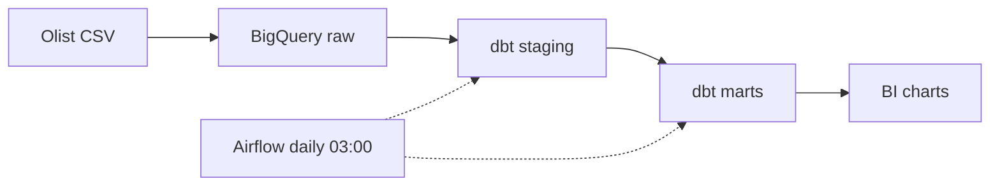

**MSc Computer Science and Engineering @ DTU** · Copenhagen 🇩🇰
BEng in Data Science and Big Data Technology

Interested in data science, data analysis, deep learning and computer vision.

---

## 🛠️ Tech stack

**Languages**

**Deep learning, computer vision & AI**

CNNs · ResNet · transfer learning · video action classification · Transformers · recommender systems · time-series forecasting (STL, Prophet)

**Data engineering & big data**

**Databases**

Data warehousing · Kimball dimensional modeling · Medallion architecture

**Web & backend**

WebSocket · web crawling and data collection

**Infra & tools**

LSF / HPC GPU batch jobs

---

## 🚀 Featured project

### [Modern E-commerce Data Platform](https://github.com/thatyuto/Modern-E-commerce-Data-Platform)

A solo batch data platform on the public Olist dataset (9 tables, ~1.55M rows). I explored in PostgreSQL first, then rebuilt the queries worth keeping as tested dbt models on BigQuery.

| 23 | 41 / 41 | ~34% |
|:---:|:---:|:---:|
| dbt models (star schema + 8 marts) | data tests passed in the last recorded run | less data scanned after partitioning (25.64 → 16.8 MB) |

- Daily Airflow schedule on Docker Compose, with retries
- Separate Spark + Delta Lake Medallion implementation on Databricks (not yet connected to BigQuery)

