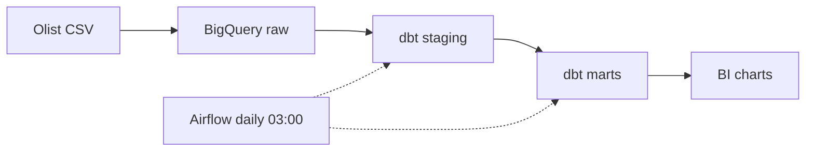

**MSc Computer Science and Engineering @ DTU** · Copenhagen 🇩🇰
BEng in Data Science and Big Data Technology

I turn one-off SQL analysis into tested, scheduled, reusable data models.

---

## 🛠️ Tech stack

**Pipelines & orchestration**

**Warehouses & languages**

**Infra & tools**

---

## 🚀 Featured project

### [Modern E-commerce Data Platform](https://github.com/thatyuto/Modern-E-commerce-Data-Platform)

A solo batch data platform on the public Olist dataset (9 tables, ~1.55M rows). I explored in PostgreSQL first, then rebuilt the queries worth keeping as tested dbt models on BigQuery.

| 23 | 41 / 41 | ~34% |
|:---:|:---:|:---:|
| dbt models (star schema + 8 marts) | data tests passed in the last recorded run | less data scanned after partitioning (25.64 → 16.8 MB) |

- Daily Airflow schedule on Docker Compose, with retries
- Separate Spark + Delta Lake Medallion implementation on Databricks (not yet connected to BigQuery)

---

## 🧭 Other work

| Project | What I did | Stack |
|---|---|---|
| **LLM medication assistant** Alibaba Cloud Big Data Lab, 2022–2024 | Co-built a funded assistant with OCR and a multi-tier cache; also trained a Transformer on clinical time-series data for a sleep apnea study | Azure OpenAI, LangChain, Python |
| **Police Big Data Platform** Course project, 2024 | Real-time vehicle metrics with a monitoring dashboard | Kafka, Spark Streaming, HBase, Phoenix |
| **2D online competitive game** BEng thesis, 2024–2025 | Rating-based matchmaking and match replay | Spring Boot, Spring Cloud, WebSocket, Redis, Vue 3 |

---

## 📊 GitHub stats

---

## 🎯 Currently

- 🎓 Studying at DTU
- 🔧 Adding CI for `dbt test` to my data platform
- 🔗 Working on connecting the Spark pipeline to BigQuery

